  
  
  

I build production web apps end to end: responsive **Next.js** frontends, **Node.js / Express** APIs, **MongoDB** and **Prisma** data layers, and the **Linux** server they run on. I deploy my own work, so what I ship stays up.

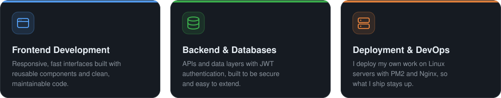

<a href="https://github.com/sharif57?tab=repositories">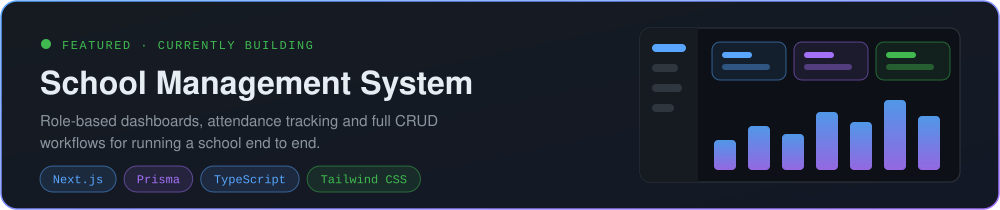</a>

<table>
  <tr>
    <td width="33%"><a href="https://github.com/sharif57?tab=repositories">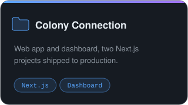</a></td>
    <td width="33%"><a href="https://github.com/sharif57?tab=repositories">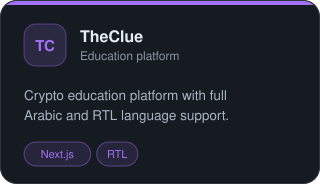</a></td>
    <td width="33%"><a href="https://github.com/sharif57?tab=repositories">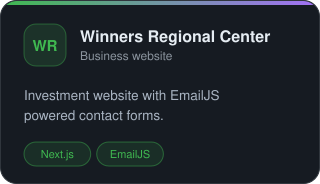</a></td>
  </tr>
  <tr>
    <td width="33%"><a href="https://github.com/sharif57?tab=repositories">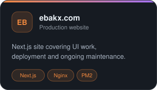</a></td>
    <td width="33%"><a href="https://github.com/sharif57?tab=repositories">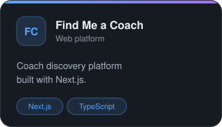</a></td>
    <td width="33%"><a href="https://github.com/sharif57?tab=repositories">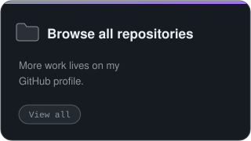</a></td>
  </tr>
</table>

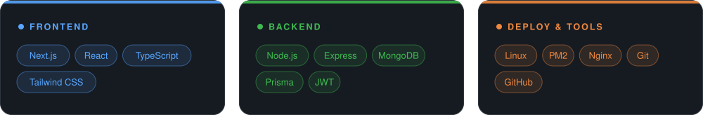

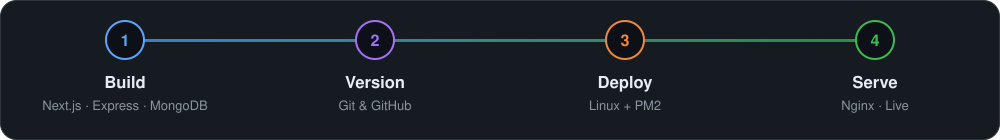

  
  

  

<picture>
  <source media="(prefers-color-scheme: dark)" srcset="https://raw.githubusercontent.com/sharif57/sharif57/output/github-snake-dark.svg">
  <source media="(prefers-color-scheme: light)" srcset="https://raw.githubusercontent.com/sharif57/sharif57/output/github-snake.svg">
  
</picture>

<a href="mailto:YOUR_EMAIL@gmail.com">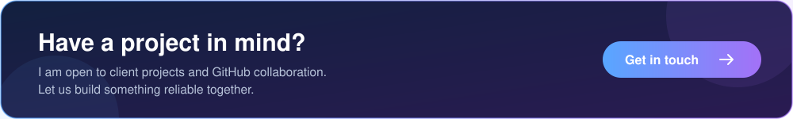</a>

  
  
  
  

