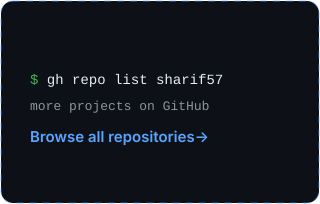
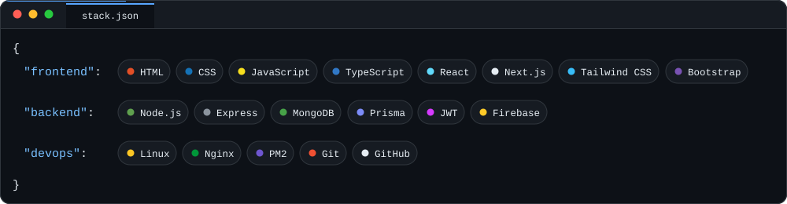
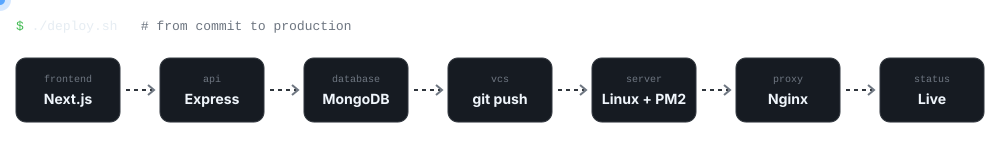

<p align="center">
  
  <a href="https://github.com/sharif57?tab=followers"></a>
  <a href="https://github.com/sharif57?tab=repositories"></a>
</p>


```ts
const sharif = {
  role: "Full Stack Developer",
  frontend: ["Next.js", "React", "TypeScript", "Tailwind CSS"],
  backend: ["Node.js", "Express", "MongoDB", "Prisma", "JWT"],
  deploy: ["Linux", "PM2", "Nginx"],
  openTo: ["GitHub collaboration", "Client projects"],
  askMeAbout: "Web development",
};
```

I build production web apps end to end: responsive Next.js frontends, Node.js / Express APIs, MongoDB and Prisma data layers, and the Linux server they run on. I deploy my own work, so what I ship stays up.


<a href="https://github.com/sharif57?tab=repositories"></a>

<table>
  <tr>
    <td width="33%"><a href="https://github.com/sharif57?tab=repositories"></a></td>
    <td width="33%"><a href="https://github.com/sharif57?tab=repositories"></a></td>
    <td width="33%"><a href="https://github.com/sharif57?tab=repositories"></a></td>
  </tr>
  <tr>
    <td width="33%"><a href="https://github.com/sharif57?tab=repositories"></a></td>
    <td width="33%"><a href="https://github.com/sharif57?tab=repositories"></a></td>
    <td width="33%"><a href="https://github.com/sharif57?tab=repositories"></a></td>
  </tr>
</table>







<p align="center">
  
  
</p>
<p align="center">
  
</p>
<p align="center">
  
</p>

<picture>
  <source media="(prefers-color-scheme: dark)" srcset="https://raw.githubusercontent.com/sharif57/sharif57/output/github-snake-dark.svg">
  <source media="(prefers-color-scheme: light)" srcset="https://raw.githubusercontent.com/sharif57/sharif57/output/github-snake.svg">
  
</picture>


<p align="center">
  <a href="https://www.linkedin.com/in/sharif-mahamud"></a>
  <a href="https://github.com/sharif57"></a>
  <a href="https://www.facebook.com/sharif.mahamud.5682"></a>
  <a href="mailto:YOUR_EMAIL@gmail.com"></a>
</p>

<p align="center">
  
</p>
